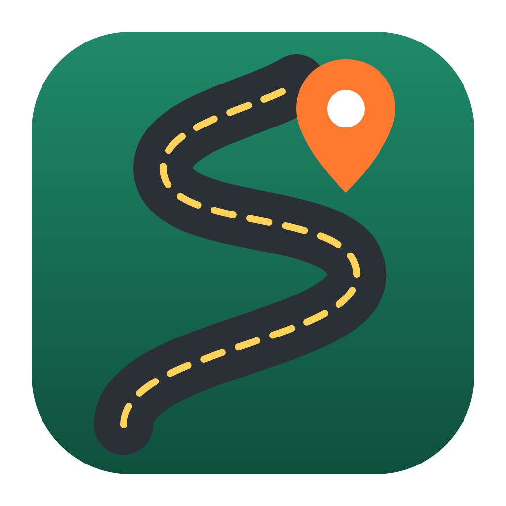

<p align="center">
  
</p>

<h1 align="center">Tourenplaner</h1>

<p align="center">
  Motorradtouren in der Gruppe planen: Etappen auf der Karte, Unterkünfte, Kosten teilen und Statistik.<br>
  Für macOS, Windows und Linux, mit Abgleich über Nextcloud bzw. WebDAV.
</p>

<p align="center">
  <a href="LICENSE"></a>
  <a href="#entstanden-mit-ki"></a>
</p>

---

## Inhalt

- [Worum geht es?](#worum-geht-es)
- [Funktionen](#funktionen)
- [Installation](#installation)
- [Erste Schritte](#erste-schritte)
- [Gemeinsam nutzen mit Nextcloud](#gemeinsam-nutzen-mit-nextcloud)
- [Online-Dienste und Datenschutz](#online-dienste-und-datenschutz)
- [Wo liegen die Daten?](#wo-liegen-die-daten)
- [Entwicklung](#entwicklung)
- [Projektstruktur](#projektstruktur)
- [Bauen und Veröffentlichen](#bauen-und-veröffentlichen)
- [Bekannte Einschränkungen](#bekannte-einschränkungen)
- [Entstanden mit KI](#entstanden-mit-ki)
- [Lizenz und Quellen](#lizenz-und-quellen)

## Worum geht es?

Der Tourenplaner ist für kleine Gruppen von etwa 3 bis 8 Personen gedacht, die ein- oder zweimal im Jahr eine mehrtägige
Motorradtour mit Übernachtungen fahren. Alles, was sonst auf Tabellen, Chat-Nachrichten und Navi-Apps verteilt ist,
steht in einer Anwendung: die Route jedes Tages, die Hotels, die Ausgaben unterwegs und am Ende die Abrechnung.

Die App läuft lokal auf dem eigenen Rechner. Ein Konto oder ein eigener Server ist nicht nötig. Wer möchte, gleicht die Daten
über einen geteilten Nextcloud-Ordner mit der Gruppe ab.

## Funktionen

### Touren
- Zeitraum, Region, Mitfahrer, Währung und Spritpreis
- Status: *Idee → In Planung → Gebucht → Gefahren*
- Überblick mit Gesamtkarte, Tagesplan (Strecke, Fahrzeit, Ankunft, Unterkunft, Wetter) und Zusammenfassung

### Etappenplaner mit Karte
- **Routing mit Motorrad-Profil**: Autobahnen meiden oder bevorzugen, Maut und Fähren meiden
- **Wegpunkte setzen**
  - Ein **Klick** auf die Karte fügt den Punkt dort in die Route ein, wo er den kleinsten Umweg macht.
  - **Umschalt+Klick** hängt den Punkt ans Ende an.
  - Marker lassen sich **ziehen** und per **Rechtsklick** entfernen.
  - Ortssuche nach Ort, Pass oder Adresse; Ortsnamen werden automatisch ermittelt.
- km und Fahrzeit für die ganze Etappe und für jedes Teilstück
- Abfahrtszeit plus Pausen ergibt die voraussichtliche Ankunft
- **Tank- und Ladestopps**: Maßgeblich ist die kleinste Reichweite in der Gruppe, abzüglich einer Reserve.
  Verbrenner und Elektromotorräder werden getrennt gerechnet (siehe [Elektromotorräder](#elektromotorräder)).
  Die Stopps erscheinen als Marker auf der Route, mit Link zur Suche nach Tankstellen bzw. Ladesäulen in der Nähe.
  Dazu kommen Verbrauch (Liter bzw. kWh) und Energiekosten.
- **Wettervorhersage** am Etappenziel, ab 16 Tagen vor der Etappe
- **GPX-Import**, z. B. kurvige Routen aus Kurviger oder Calimoto oder aufgezeichnete Tracks
- **GPX-Export** für Garmin, TomTom, Calimoto & Co., als Route und Track
- Etappe in Google Maps öffnen
- „Nächste Etappe ab hier“: Die neue Etappe startet am Ziel bzw. am Hotel des Vortags.
- **Mitfahrer je Etappe**: Ohne Auswahl fahren alle mit. Es lassen sich aber auch einzelne Personen wählen,
  z. B. Tag 1 Anreise nur für B und C zum Wohnort von A, Tag 2 Rundfahrt mit allen, Tag 3 Rückreise nur für B und C.
  Tank- und Ladestopps, Verbrauch, die km-Statistik je Person und die vorgeschlagene Kostenaufteilung richten sich danach.
- Tatsächlich gefahrene km und Fahrzeit nachtragen

### Unterkünfte
- Lage auf der Karte, Zeitraum, Status (Idee, Angefragt, Gebucht, Storniert)
- Preis für die Gruppe mit Anzeige pro Person und Nacht, wer bezahlt hat, auf wen der Preis verteilt wird
- Garage bzw. sicherer Stellplatz fürs Motorrad, Lademöglichkeit fürs E-Motorrad, Frühstück, Telefon, Buchungsnummer, Link
- Hinweis auf Nächte, für die noch keine Unterkunft eingetragen ist

### Kosten teilen
- Ausgaben mit Kategorie (Sprit, Laden, Essen, Maut, Fähre …), Datum und Zahler
- **Fremdwährungen** mit Umrechnungskurs (CHF, NOK, GBP …)
- Aufteilung auf alle Mitfahrer oder nur auf einzelne
- Unterkünfte fließen automatisch in die Abrechnung ein.
- Salden je Person und **„Wer zahlt wem?“** mit möglichst wenigen Überweisungen, als Text kopierbar (z. B. für WhatsApp)
- Kosten nach Kategorie; Schätzung für Sprit und Strom, solange noch keine Tank- bzw. Ladebelege erfasst sind

### Und außerdem
- **Checkliste** je Tour aus einer anpassbaren Vorlage (Papiere, Vignetten, Technik, Ausrüstung), jeder Punkt mit Zuständigkeit
- **Dokumente** je Tour per Drag & Drop (Buchungsbestätigungen, Tickets, GPX, Fotos); sie werden mitsynchronisiert
- **Roadbook als PDF** mit Tagesplan, Unterkünften, Wegpunkten, Kontakten und Abrechnung
- **Mitfahrer** mit Motorrad, Antrieb (Verbrenner oder Elektro), Reichweite, Verbrauch, Telefon und Notfallkontakt
- **Übersicht** mit Countdown zur nächsten Tour und offenen Punkten
- **Statistik** über alle Touren: km pro Jahr, Ø km pro Tag, Ø km/h, längster Tag,
  Kosten pro Person und pro km, km je Mitfahrer
- **Informationsfenster** „Über Tourenplaner“ mit Version, Autor, Lizenz und Entstehung (unten in der Seitenleiste)
- Hell- und Dunkelmodus folgen der Systemeinstellung.

### Elektromotorräder

Bei jedem Mitfahrer lässt sich der Antrieb wählen: **Verbrenner** oder **Elektro**.

| | Verbrenner | Elektro |
| --- | --- | --- |
| Verbrauch | l/100 km | kWh/100 km |
| Reichweite | je Tankfüllung | je Akkuladung |
| Preis (je Tour) | Spritpreis je Liter | Strompreis je kWh an der Ladesäule |
| Zusätzliche Zeit | steckt in den normalen Pausen | Dauer eines Ladestopps je Mitfahrer, wird zur Ankunftszeit addiert |

So wird gerechnet:

- Gerechnet wird je Etappe nur mit den Motorrädern, die diese Etappe mitfahren.
- Für jeden Antrieb zählt die **kleinste Reichweite** der Motorräder mit diesem Antrieb, abzüglich der Reserve
  (*Einstellungen → Planung → Reichweiten-Reserve*, Standard 80 %). Fährt ein E-Motorrad mit, bestimmt es
  meist den Takt der Gruppe.
- Jede Etappe beginnt mit vollem Tank bzw. Akku, denn über Nacht wird im Hotel geladen. Fehlt bei der
  Unterkunft des Abends die Lademöglichkeit, weist der Etappenplaner darauf hin.
- Die Ladezeit kommt einmal pro Ladestopp dazu. Es zählt der längste Ladestopp in der Gruppe, weil alle warten.
- Verbrauch und Kosten werden je Antrieb geschätzt und in den Kosten pro Person berücksichtigt. Sobald Ausgaben
  der Kategorie „Sprit“ bzw. „Laden“ erfasst sind, ersetzen sie die jeweilige Schätzung.

## Installation

### Fertige Pakete

Sobald Releases veröffentlicht sind, liegen dort die Installer:

| System | Datei |
| --- | --- |
| macOS (Apple Silicon und Intel) | `Tourenplaner_x.y.z_universal.dmg` |
| Windows | `Tourenplaner_x.y.z_x64-setup.exe` oder `.msi` |
| Linux | `.AppImage` oder `.deb` |

Die App ist **nicht signiert**. Darum gilt beim ersten Start:

- **macOS:** Rechtsklick auf die App → *Öffnen*. Alternativ, wenn sie heruntergeladen wurde:
  ```bash
  xattr -dr com.apple.quarantine /Applications/Tourenplaner.app
  ```
- **Windows:** Im SmartScreen-Hinweis *Weitere Informationen → Trotzdem ausführen* wählen.

### Selbst bauen

Siehe [Entwicklung](#entwicklung) und [Bauen und Veröffentlichen](#bauen-und-veröffentlichen).

## Erste Schritte

1. Unter **Mitfahrer** die Gruppe anlegen, mit Motorrad, Antrieb, Reichweite und Verbrauch.
   Bei dir selbst auf **„Das bin ich“** klicken. Diese Einstellung gilt nur auf dem eigenen Rechner;
   du wirst dann als Zahler vorausgewählt.
2. Mit **+ Neue Tour** eine Tour anlegen und im Tab *Überblick* Zeitraum, Region und Mitfahrer eintragen.
3. Im Tab **Etappen & Karte** pro Tag eine Etappe anlegen. Start und Ziel suchen oder auf die Karte klicken,
   Zwischenziele dazwischen setzen. Die Route wird automatisch berechnet.
4. Im Tab **Unterkünfte** die Hotels eintragen. Bei einem Hotel für den Etappentag lässt es sich per
   „Hotel als Ziel“ direkt als Etappenziel übernehmen.
   Fährt eine Etappe nicht die ganze Gruppe, bei der Etappe unter **„Wer fährt mit?“** die Personen auswählen.
5. Unterwegs im Tab **Kosten** die Ausgaben erfassen. Am Ende steht dort, wer wem wie viel überweist.
   Eine neue Ausgabe wird zunächst auf die Personen verteilt, die an dem Tag fahren; das lässt sich je Ausgabe ändern.

## Gemeinsam nutzen mit Nextcloud

Der Abgleich läuft direkt aus der App per WebDAV. Der Nextcloud-Desktop-Client wird **nicht** benötigt.

1. Einer legt in Nextcloud einen Ordner an, z. B. `Motorrad/Tourenplaner`, und **teilt ihn mit allen Mitfahrern
   mit Bearbeitungsrecht**.
2. Jeder erstellt in Nextcloud unter *Einstellungen → Sicherheit* ein **App-Passwort**.
3. In der App unter *Einstellungen → Daten & Sync* eintragen:
   - **Server-Adresse:** z. B. `https://cloud.example.com`
   - **Benutzername und App-Passwort:** der eigene Zugang. Das Passwort landet im Schlüsselbund des Systems.
   - **Ordner auf dem Server:** der Pfad, unter dem der geteilte Ordner **beim jeweiligen Benutzer** erscheint
   - optional: automatisch alle 5, 15 oder 60 Minuten abgleichen
4. Mit *Verbindung testen* prüfen und anschließend *Jetzt synchronisieren* klicken.

**So funktioniert der Abgleich**

- Jede Tour, Etappe, Unterkunft und Ausgabe ist eine eigene kleine Datei. Bearbeiten zwei Personen gleichzeitig
  verschiedene Einträge, entsteht kein Konflikt.
- Ändern zwei Geräte denselben Eintrag, gewinnt der neuere Stand. Der andere wird lokal unter `conflicts/` aufbewahrt.
- Ist eine Seite komplett leer (neuer Rechner oder neuer Server-Ordner), wird nichts gelöscht.
  Stattdessen übernimmt die leere Seite alles von der anderen.

Statt Nextcloud funktioniert jeder andere WebDAV-Server. Dann die vollständige WebDAV-URL als Server-Adresse eintragen.

## Online-Dienste und Datenschutz

Die App nutzt nur freie Dienste ohne API-Schlüssel. Die Anfragen gehen über das Rust-Backend der App,
und nur die folgenden Adressen sind freigegeben:

| Zweck | Dienst | Was übertragen wird |
| --- | --- | --- |
| Routing (Motorrad) | [Valhalla](https://valhalla.github.io/valhalla/) auf `valhalla1.openstreetmap.de` (FOSSGIS e. V.) | Koordinaten der Wegpunkte |
| Ortssuche und Ortsnamen | [Nominatim](https://nominatim.org/) auf `nominatim.openstreetmap.org` | Suchbegriff bzw. Koordinate |
| Wetter | [Open-Meteo](https://open-meteo.com/) | Koordinate des Etappenziels, Datum |
| Kartenkacheln | OpenStreetMap, Esri, OpenTopoMap | angezeigter Kartenausschnitt |

Namen, Kosten und andere Tourdaten verlassen den Rechner nur über den eigenen Nextcloud- bzw. WebDAV-Server.
Bitte die Nutzungsbedingungen der öffentlichen Server beachten: Sie sind für gelegentliche private Nutzung gedacht,
nicht für Massenabfragen.

## Wo liegen die Daten?

Standardmäßig liegen die Daten im App-Datenordner. Unter *Einstellungen → Daten & Sync* lässt sich ein anderer Ordner wählen.

| System | Ordner |
| --- | --- |
| macOS | `~/Library/Application Support/de.soeren3003.tourenplaner/data` |
| Windows | `%APPDATA%\de.soeren3003.tourenplaner\data` |
| Linux | `~/.local/share/de.soeren3003.tourenplaner/data` |

So ist der Datenordner aufgebaut:

```
db/tours/<id>.json        Touren inkl. Checkliste
db/stages/<id>.json       Etappen: Wegpunkte, Routenverlauf (Polyline), km, Fahrzeit
db/hotels/<id>.json       Unterkünfte
db/expenses/<id>.json     Ausgaben
db/members/<id>.json      Mitfahrer
db/settings/settings.json Vorgaben (Währung, Spritpreis, Checklisten-Vorlage …)
files/<tour-id>/…         Dokumente je Tour
conflicts/                nur lokal: ältere Version bei Sync-Konflikten
```

Alle Dateien sind lesbares JSON. Für eine Sicherung genügt eine Kopie des Ordners.
Die Zugangsdaten (Server, Benutzer, Ordner) liegen getrennt in `config.json` im Konfigurationsordner der App,
das Passwort im System-Schlüsselbund.

## Entwicklung

**Voraussetzungen**

- [Node.js](https://nodejs.org/) 20 oder neuer
- [Rust](https://www.rust-lang.org/) (stable)
- macOS: Xcode Command Line Tools; Linux: die
  [Tauri-Abhängigkeiten](https://tauri.app/start/prerequisites/) (`libwebkit2gtk-4.1-dev` u. a.)

Unter macOS z. B.:

```bash
brew install node rust
```

**Starten**

```bash
npm install
npm run tauri dev      # Desktop-App mit Hot-Reload
npm run dev            # nur die Oberfläche im Browser (http://localhost:1420), Daten im localStorage
```

**Tests**

```bash
npm test                         # Kostenaufteilung, Tank- und Ladestopps, Polyline, GPX
cd src-tauri && cargo test       # WebDAV-URLs, XML-Parser, Host-Freigabe
```

Sync-Integrationstest gegen einen lokalen WebDAV-Server:

```bash
pip install wsgidav cheroot
mkdir -p /tmp/dav/remote.php/dav/files/test
wsgidav --host=127.0.0.1 --port=8765 --root=/tmp/dav --auth=anonymous &
cd src-tauri && TOURENPLANER_TEST_DAV=http://127.0.0.1:8765 cargo test --test sync_dav
```

## Projektstruktur

```
├── src/                      Oberfläche (React + TypeScript)
│   ├── App.tsx               Navigation und Seitenaufbau
│   ├── components/           Karte (Leaflet), Diagramme, Wetter, Eingabefelder, Info-Fenster
│   ├── pages/                Übersicht, Touren, Mitfahrer, Statistik, Einstellungen
│   │   └── tour/             Tabs einer Tour: Überblick, Etappen, Unterkünfte, Kosten, Checkliste, Dokumente
│   ├── lib/
│   │   ├── types.ts          Datenmodell
│   │   ├── store.tsx         Laden, verzögertes Speichern, Sync-Auslösung
│   │   ├── calc.ts           Kostenaufteilung, Salden, Überweisungen, Tank- und Ladestopps, Statistik
│   │   ├── geo.ts            Entfernungen, Polyline, Einfügeposition, GPX lesen/schreiben
│   │   ├── services.ts       Routing, Ortssuche, Wetter
│   │   ├── export.ts         GPX-Export und Roadbook-PDF
│   │   └── api.ts            Aufrufe ins Rust-Backend (mit Browser-Ersatz für die Entwicklung)
│   └── styles.css
├── src-tauri/                Desktop-Hülle und Backend (Rust, Tauri 2)
│   ├── src/
│   │   ├── lib.rs            Tauri-Befehle
│   │   ├── store.rs          JSON-Datensätze und Dokumente im Datenordner
│   │   ├── sync.rs           Zwei-Wege-Abgleich mit Konfliktbehandlung
│   │   ├── webdav.rs         schlanker WebDAV-Client
│   │   ├── web.rs            freigegebene Online-Dienste
│   │   └── config.rs         lokale Einstellungen, Passwort im Schlüsselbund
│   ├── tests/sync_dav.rs     Integrationstest gegen echten WebDAV-Server
│   ├── icons/                App-Symbole (aus app-icon.svg erzeugt)
│   └── tauri.conf.json
├── .github/workflows/build.yml   Builds für macOS, Windows und Linux
└── app-icon.svg              Quelle des App-Symbols
```

## Bauen und Veröffentlichen

### Lokal (macOS)

```bash
npm run tauri build                     # .app und .dmg unter src-tauri/target/release/bundle/
npm run tauri build -- --bundles app    # nur die .app
cp -R src-tauri/target/release/bundle/macos/Tourenplaner.app /Applications/
```

Windows- und Linux-Pakete müssen auf dem jeweiligen System gebaut werden.

### Über GitHub Actions

Der Workflow `.github/workflows/build.yml` baut alle drei Plattformen und führt vorher die Tests aus:

- manuell unter *Actions → Build → Run workflow*
- automatisch bei einem Versions-Tag:
  ```bash
  git tag v0.1.0
  git push origin v0.1.0
  ```

Die Installer hängen danach als Artefakte am Workflow-Lauf und können in ein Release übernommen werden.

### Codeberg

Codeberg nutzt Forgejo Actions. Der Workflow ist weitgehend kompatibel, braucht dort aber einen Runner mit macOS
bzw. Windows, und den bietet Codeberg nicht an. Praktikabel sind zwei Wege:

- das Repository auf Codeberg pflegen und nach GitHub spiegeln, nur um dort zu bauen
- die Pakete lokal bauen und als Release-Anhänge hochladen

### Versionen

Die Versionsnummern folgen der [semantischen Versionierung](https://semver.org/lang/de/) (`MAJOR.MINOR.PATCH`).
Was sich in welcher Version geändert hat, steht im [CHANGELOG.md](CHANGELOG.md).

So entsteht eine neue Version:

```bash
npm run set-version -- 1.2.0     # setzt die Nummer in package.json, Cargo.toml, tauri.conf.json und den Lockfiles
# CHANGELOG.md ergänzen, dann:
git commit -am "Version 1.2.0"
git tag -a v1.2.0 -m "Version 1.2.0"
```

## Bekannte Einschränkungen

- Das Routing-Profil kennt keine echte „Kurvigkeit“. „Autobahnen meiden“ kommt dem nahe. Für ausgesprochen
  kurvige Strecken plant man am besten in Kurviger oder Calimoto und importiert die Route als GPX.
- Die öffentlichen Routing- und Suchserver haben Nutzungsgrenzen. Bei sehr vielen Anfragen kann es kurz zu Fehlern kommen.
- Die Wettervorhersage gibt es frühestens 16 Tage vor der Etappe.
- Blockiert der OpenStreetMap-Kachelserver die App, wechselt die Karte automatisch zur Esri-Straßenkarte.
  Über das Ebenen-Symbol oben rechts lässt sich jederzeit umschalten.

## Entstanden mit KI

Der Tourenplaner ist in **Zusammenarbeit mit der KI [Claude](https://claude.ai) von Anthropic** entstanden.
Genutzt wurde dafür [Claude Code](https://claude.com/claude-code).

Die Aufgaben waren so verteilt:

- **Mensch (Soeren3003):** Idee und Anforderungen aus der Praxis einer Motorrad-Reisegruppe, Entscheidungen
  über Funktionen, Aufbau, Lizenz und Veröffentlichung, Prüfen und Ausprobieren der Ergebnisse.
- **KI (Claude):** Entwurf der Architektur, Schreiben des Großteils des Quellcodes, der Tests und dieser
  Dokumentation, Vorschläge für zusätzliche Funktionen (z. B. Tankstopps, Wetter, GPX, Roadbook, Checkliste).

Commits, an denen die KI mitgearbeitet hat, sind in der Versionsgeschichte mit
`Co-Authored-By: Claude …` gekennzeichnet.

Der Code ist mit automatischen Tests abgesichert und wurde während der Entwicklung in der App ausprobiert. Wie bei jeder Software können
trotzdem Fehler enthalten sein. Hinweise und Verbesserungen sind ausdrücklich willkommen.

## Lizenz und Quellen

Der Tourenplaner ist freie Software unter der **[MIT-Lizenz](LICENSE)**. Jeder darf ihn nutzen, verändern und
weitergeben, auch kommerziell, solange der Copyright- und Lizenzhinweis erhalten bleibt. Die Software wird ohne
Gewährleistung bereitgestellt.

Beiträge sind willkommen. Mit einem Pull Request erklärst du dich einverstanden, dass dein Beitrag ebenfalls
unter der MIT-Lizenz steht.

Verwendete Bibliotheken und Daten:

- [Tauri](https://tauri.app/), [React](https://react.dev/), [Vite](https://vitejs.dev/)
- [Leaflet](https://leafletjs.com/) für die Karte, [jsPDF](https://github.com/parallax/jsPDF) für das Roadbook
- Kartendaten © [OpenStreetMap](https://www.openstreetmap.org/copyright)-Mitwirkende (ODbL).
  Kartenkacheln von OpenStreetMap, [OpenTopoMap](https://opentopomap.org/) (CC-BY-SA) und Esri
- Routing: [Valhalla](https://github.com/valhalla/valhalla), betrieben vom [FOSSGIS e. V.](https://www.fossgis.de/)
- Wetterdaten: [Open-Meteo](https://open-meteo.com/) (CC BY 4.0)
